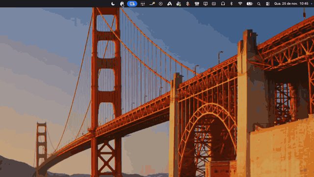

# Robusta

**English** · [Português](README.pt-BR.md)

**Keep your Mac awake at the right time for your routines, automations and local AI agents.** Robusta schedules when your Mac wakes or powers on (its **shots**), even with the lid closed, so Claude Code, Codex, Orca, backups and scripts running on your machine find the Mac ready.

It extends macOS's limit on scheduled wake times: instead of a single recurring time, as many as you want.

**Author:** [brunotemum.site](https://brunotemum.site)



> [!TIP]
> ### ☕ Support Robusta
> Robusta is free. If it helps you, instead of buying me a coffee, make a donation to **COIAB**, the Coordination of Indigenous Organizations of the Brazilian Amazon.
>
> [](https://coiab.org.br/doe-agora/)

## Installation

Requirements: macOS 27 and a Mac with Apple silicon.

1. Download `Robusta-0.1.0.dmg` from [Releases](https://github.com/sjbruno/robusta-app/releases).
2. Open the `.dmg` and drag **Robusta** to **Applications**.
3. Open Robusta. If macOS blocks it, allow it once:
   - click **Done**;
   - open **System Settings > Privacy & Security**;
   - under **Security**, click **Open Anyway** and confirm with your password or Touch ID.

   The block appears because Robusta isn't notarized by Apple (that requires a paid account). The code is open and all here.
4. Click the coffee bean in the menu bar, then **Authorize…**. Enter your Mac password once.
5. In the gear menu, turn on **Open at Login**.

## How it works

- **Shots:** times when your Mac wakes or powers on. Create one with **New shot**, picking the time and days.
- **Native schedule:** the only recurring schedule macOS itself keeps. It works even with Robusta closed or uninstalled. Use it for your most important schedule.
- **Single shot:** happens once and leaves the list.
- **Full pot:** keeps your Mac awake through a time window (for example, 9 AM to 6 PM), even with the lid closed. To work, your Mac must be plugged in.
- **Caffeine lasts:** after each shot, Robusta keeps your Mac awake for a few minutes (10 by default) so your automations have time to start.
- **Automations:** the Automations tab finds the routines scheduled in Orca, Codex and Claude Desktop and shows whether each one has a shot at the right time. If not, the **+ Shot** button creates the missing one.
- **Daily refill:** Robusta keeps the shots for the next 14 days scheduled and refills the list on its own every day, even with the app closed.
- **AI agents:** in **Settings > Shots**, under **AI agents**, **Copy** gives you a text to paste into the AI agent you use (Claude Code, Codex…). From then on it can list, create and remove shots for you, and it asks you before removing anything. The native schedule can only be changed in the app.

## Privacy and security

- Robusta only uses the internet when you click **Check for Updates**, to see the latest version on GitHub. None of your data is sent.
- From automations, it reads **only the name and time**. It never reads their content, instructions or results.
- It only shows shots from other apps and the system. It never deletes them.
- The command Robusta gives to AI agents does only what the app does, with the same authorization: wake and power-on shots, only Robusta's own. It runs on your Mac and sends nothing anywhere.
- The authorization in step 4 only allows the macOS energy scheduler (`pmset`), only for Robusta's own shots. You can remove it in **Settings > Remove authorization…**.

## Updating

In **Settings > About Robusta**, click **Check for Updates**. If there's a new version, download the `.dmg` and drag Robusta to Applications again, replacing the old one. Your schedules stay.

## Uninstalling

In **Settings > Uninstall Robusta…**. Robusta:
1. cancels the shots it scheduled and deletes your schedules and full pots;
2. asks whether to keep or remove the native schedule (macOS keeps it on its own, and it works without Robusta);
3. turns off the daily refill and "Open at Login";
4. deletes the instructions file you installed in an AI agent, if any;
5. deletes its activity log;
6. removes its authorization (asks for your password).

Then drag Robusta from Applications to the Trash. Wakes from other apps and the system are left alone.

## Troubleshooting

- **Shots don't appear or aren't created:** check in **Settings > Authorization** that it's active.
- **Daily refill shows "Waiting for approval":** open **System Settings > General > Login Items** and turn Robusta on.
- **Log of what Robusta did:** `~/Library/Logs/Robusta/robusta.log`.

---

## For developers

### Building

Requirements: full Xcode (App Store) and [XcodeGen](https://github.com/yonaskolb/XcodeGen) (`brew install xcodegen`). No developer account needed: the app uses ad hoc signing.

```sh
git clone https://github.com/sjbruno/robusta-app.git
cd robusta-app
swift test --package-path Packages/RobustaCore   # core and tests
xcodegen generate                                 # generates the Xcode project
xcodebuild -project Robusta.xcodeproj -scheme Robusta -configuration Release build
```

How the app works, the code layout and the security rules a change must not break are in [`ARCHITECTURE.md`](ARCHITECTURE.md).

### How permission works under the hood

Writing to `pmset` requires root, and Robusta handles it **without running any of its own code as root**:
- **Authorize…** writes `/etc/sudoers.d/robusta`, which allows without a password only Apple's `/usr/bin/pmset` (protected by SIP), with rules that restrict the arguments: only the app's owners, only wake/power on, never `cancelall` or cancel-by-index. The template is in [`Install/robusta.sudoers.template`](Install/robusta.sudoers.template) and is checked with `visudo` before being written;
- the daily refill (`robusta-renew`) runs as your user, through a login agent.

### Using another macOS version or an Intel Mac

Robusta is built and tested only for macOS 27 on Apple silicon. To adapt it, the simplest path is to clone the repository and ask a coding agent (Claude Code, Codex, Cursor, etc.) to do it following [`ARCHITECTURE.md`](ARCHITECTURE.md):

1. **Minimum version:** change the target in `project.yml` (`deploymentTarget`) and in `Packages/RobustaCore/Package.swift` (`platforms`). The code uses no macOS 27-only API today (any that is added gets a `// macOS 27+` comment). The theoretical floor is macOS 15 (`Tab` in Settings and `onScrollGeometryChange`).
2. **Intel Mac:** change `ARCHS: arm64` in `project.yml` to `x86_64` or `"arm64 x86_64"`.
3. **`pmset` format:** save the output of `pmset -g sched` as a new fixture and run the tests, including `SystemReaderTests`, which compares the reading with the system.
4. **Don't relax security:** keep the sudoers restricted to `/usr/bin/pmset` and `SudoersTemplateTests` passing.

## License

[MIT](LICENSE)
