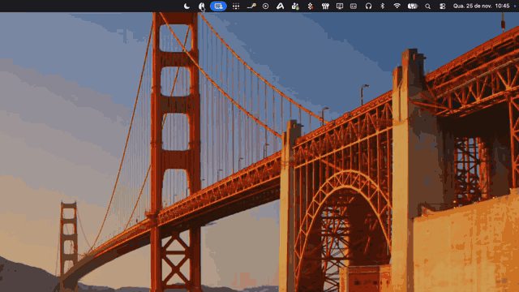

# Robusta

[English](README.md) · **Português**

**Mantenha o Mac acordado na hora certa para as suas rotinas, automações e agentes de IA locais.** O Robusta agenda quando o Mac acorda ou liga (as **doses**), mesmo de tampa fechada, para que Claude Code, Codex, Orca, backups e scripts que rodam na sua máquina encontrem o Mac pronto.

Ele expande o limite do macOS para agendar o despertar do Mac: em vez de um único horário recorrente, quantos você quiser.

**Autor:** [brunotemum.site](https://brunotemum.site)



> [!TIP]
> ### ☕ Apoie o Robusta
> O Robusta é gratuito. Se ele for útil para você, em vez de me pagar um café, faça uma doação para a **COIAB**, a Coordenação das Organizações Indígenas da Amazônia Brasileira.
>
> [](https://coiab.org.br/doe-agora/)

## Instalação

Requisitos: macOS 27 e Mac com Apple silicon.

1. Baixe o `Robusta-0.1.0.dmg` em [Releases](https://github.com/sjbruno/robusta-app/releases).
2. Abra o `.dmg` e arraste o **Robusta** para **Aplicativos**.
3. Abra o Robusta. Se o macOS bloquear, libere uma vez só:
   - clique em **OK**;
   - abra **Ajustes do Sistema > Privacidade e Segurança**;
   - em **Segurança**, clique em **Abrir Mesmo Assim** e confirme com a senha ou o Touch ID.

   O bloqueio aparece porque o Robusta não é notarizado pela Apple (isso exige uma conta paga). O código é aberto e está todo aqui.
4. Clique no grão de café na barra de menus e em **Autorizar…**. Digite a senha do Mac uma vez.
5. Na engrenagem, ligue **Abrir no login**.

## Como funciona

- **Doses:** horários em que o Mac acorda ou liga. Crie em **Nova dose**, escolhendo o horário e os dias.
- **Recorrência nativa:** a única recorrência que o próprio macOS guarda. Ela vale mesmo com o Robusta fechado ou desinstalado. Use na agenda mais importante.
- **Dose única:** acontece uma vez e some da lista.
- **Bule cheio:** mantém o Mac acordado numa faixa de horário (por exemplo, das 9h às 18h), mesmo de tampa fechada. Para funcionar, o Mac precisa estar ligado na tomada.
- **Efeito da dose:** depois de cada dose, o Robusta mantém o Mac acordado por alguns minutos (10, por padrão), para as suas automações terem tempo de começar.
- **Automações:** a aba Automações encontra as rotinas agendadas no Orca, no Codex e no Claude Desktop e mostra se cada uma tem uma dose na hora certa. Se não tiver, o botão **+ Dose** cria a dose que falta.
- **Reabastecimento diário:** o Robusta mantém as doses dos próximos 14 dias agendadas e repõe a lista sozinho todo dia, mesmo com o app fechado.
- **Agentes de IA:** em **Ajustes > Doses**, em **Agentes de IA**, **Copiar** dá um texto para você colar no agente de IA que usa (Claude Code, Codex…). Depois disso, ele cria, lista e remove doses por você, e pergunta antes de remover. A recorrência nativa só muda no app.

## Privacidade e segurança

- O Robusta só usa a internet quando você clica em **Procurar atualizações**, para ver a última versão no GitHub. Nenhum dado seu é enviado.
- Das automações, ele lê **só o nome e o horário**. Nunca lê o conteúdo, as instruções nem os resultados.
- Ele só mostra as doses de outros apps e do sistema. Não apaga nenhuma delas.
- O comando que o Robusta dá aos agentes de IA faz só o que o app faz, com a mesma autorização: doses de despertar e ligar, só as do próprio Robusta. Roda no seu Mac e não envia nada.
- A autorização do passo 4 libera só o agendador de energia do macOS (`pmset`), só para as doses do próprio Robusta. Dá para remover em **Ajustes > Remover autorização…**.

## Atualizar

Em **Ajustes > Sobre o Robusta**, clique em **Procurar atualizações**. Se houver versão nova, baixe o `.dmg` e arraste o Robusta para Aplicativos de novo, substituindo o anterior. As suas agendas continuam.

## Desinstalar

Em **Ajustes > Desinstalar o Robusta…**. O Robusta:
1. cancela as doses que ele agendou e apaga as suas agendas e bules cheios;
2. pergunta se você quer manter ou remover a recorrência nativa (ela fica guardada no macOS e funciona sem o Robusta);
3. desliga o reabastecimento diário e o "Abrir no login";
4. apaga o arquivo de instruções que você instalou num agente de IA, se houver;
5. apaga o histórico de atividade (log);
6. remove a autorização (pede a senha).

Depois, é só arrastar o Robusta da pasta Aplicativos para o Lixo. As doses de outros apps e do sistema não são tocadas.

## Problemas

- **As doses não aparecem ou não são criadas:** confira em **Ajustes > Autorização** se ela está ativa.
- **O reabastecimento diário aparece como "Aguardando aprovação":** abra **Ajustes do Sistema > Geral > Itens de Início** e ligue o Robusta.
- **Registro do que o Robusta fez:** fica em `~/Library/Logs/Robusta/robusta.log`.

---

## Para desenvolvedores

### Compilar

Pré-requisitos: Xcode completo (App Store) e o [XcodeGen](https://github.com/yonaskolb/XcodeGen) (`brew install xcodegen`). Não precisa de conta de desenvolvedor: o app usa assinatura ad hoc.

```sh
git clone https://github.com/sjbruno/robusta-app.git
cd robusta-app
swift test --package-path Packages/RobustaCore   # núcleo e testes
xcodegen generate                                 # gera o projeto do Xcode
xcodebuild -project Robusta.xcodeproj -scheme Robusta -configuration Release build
```

Como o app funciona, a organização do código e as regras de segurança que uma mudança não pode quebrar estão no [`ARCHITECTURE.md`](ARCHITECTURE.md) (em inglês).

### Como a permissão funciona por dentro

Escrever no `pmset` exige root, e o Robusta resolve isso **sem rodar código próprio como root**:
- o "Autorizar…" grava `/etc/sudoers.d/robusta`, que libera sem senha só o `/usr/bin/pmset` da Apple (protegido pelo SIP), com regras que limitam os argumentos: só os owners do app, só ligar/despertar, nunca `cancelall` nem cancelamento por número. O modelo está em [`Install/robusta.sudoers.template`](Install/robusta.sudoers.template) e é validado com `visudo` antes de ser gravado;
- o reabastecimento diário (`robusta-renew`) roda como o seu usuário, por um agente de login.

### Usar em outra versão do macOS ou em Mac Intel

O Robusta é feito e testado só para o macOS 27 em Apple silicon. Para adaptar, o caminho mais simples é clonar o repositório e pedir a um agente de código (Claude Code, Codex, Cursor etc.) que faça a adaptação seguindo o [`ARCHITECTURE.md`](ARCHITECTURE.md):

1. **Versão mínima:** mudar o alvo no `project.yml` (`deploymentTarget`) e no `Packages/RobustaCore/Package.swift` (`platforms`). Hoje o código não usa nenhuma API exclusiva do macOS 27 (as que entrarem levam o comentário `// macOS 27+`). O piso teórico é o macOS 15 (`Tab` nos Ajustes e `onScrollGeometryChange`).
2. **Mac Intel:** trocar `ARCHS: arm64` no `project.yml` por `x86_64` ou `"arm64 x86_64"`.
3. **Formato do `pmset`:** salvar a saída de `pmset -g sched` como fixture nova e rodar os testes, incluindo o `SystemReaderTests`, que compara a leitura com o sistema.
4. **Não relaxar a segurança:** manter o sudoers restrito ao `/usr/bin/pmset` e o `SudoersTemplateTests` passando.

## Licença

[MIT](LICENSE)
